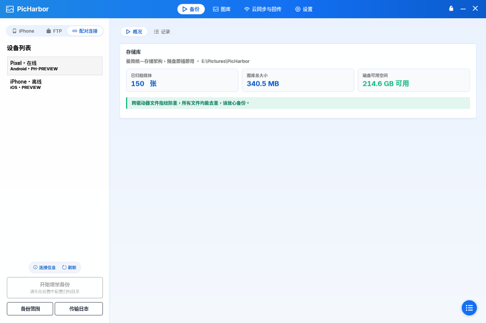
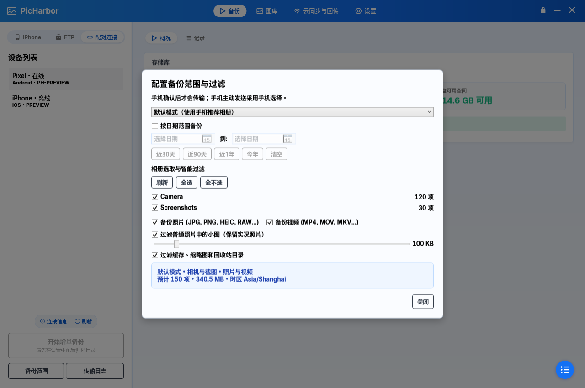

# 配对连接与备份范围：实现及验收记录

## 交付行为

- 备份页提供 iPhone、FTP、配对连接三个同级模式。原无线接收卡片和入口按钮已合并到配对模式。
- 设备列表保留离线配对；连接信息展示地址、完整证书指纹、二维码与短时配对码。刷新保持原配对身份。
- 归档目录使用全局设置，未配置时可从连接信息前往设置。三个模式共用原有右侧概况、记录和存储概览；配对任务状态留在左侧主按钮，手机主动发送使用确认弹窗。
- 配对连接标签使用链环图标，仅此模式的连接信息和刷新采用小悬浮按钮样式。iPhone 与 FTP 的原悬浮菜单按原样保留。
- 默认、全量、日期、高级范围按设备身份保存于 `%LocalAppData%/PicHarbor/link/scopes.json`，与 FTP 配置独立。
- 相册、日期、类型、小图阈值、缓存规则取交集。高级模式支持日期。目录采用手机的稳定标识，不以显示名称匹配。
- 电脑发起采用电脑范围；手机主动发送采用手机选择。任何传输均需要接收方确认。
- iPhone 默认使用系统照片图库与截图；原始文件大小来自已导出且版本一致的缓存，未知大小的原件保留。预览不下载 iCloud 原件。
- 实况照片按一个媒体项目确认，保留组成资源；任一组成文件无法读取时不单独发送另一部分。
- 手机失败、拒绝或电脑取消后释放请求，允许重新发起；增量去重避免已完成内容重复归档。

## 协议约定

仍使用已配对会话的 TLS、证书固定和 Bearer 认证。

- `/v1/hello` 双方通告 `scope2`、`catalog2` 能力。未通告完整能力的旧手机仅提供全量、日期范围选择。
- `GET /v1/catalog`：手机读取电脑当前的目录/预览请求，包含 `revision` 和范围字符串。
- `POST /v1/catalog`：手机回报相册标识、名称、数量、已知大小、默认标记、本地时区及本次筛选数量。旧修订回复不会替换当前预览。
- 结构化范围使用 `scope2:` 加 JSON，包含 mode、albums、dateEnabled、from/to、photos/videos、ignoreSmallImages、minImageKb、filterCache。旧版 `all`、`range:起日:止日` 继续解析；未知版本失败，不退回全量。
- `/v1/offers/{id}/finish` 可带 success/error，失败也释放请求；缺省请求体兼容旧客户端。
- 手机不能通过自己的 `/accept` 请求确认手机主动发送；该确认必须由电脑 UI 作出。

## 已完成验证

- 桌面端：WPF 编译（0 警告 / 0 错误）；17 项 Link 测试通过，覆盖范围序列化、无效范围、目录修订过期、能力限制、双向确认、失败后重试、原有归档与去重测试。
- Android：40 项单元测试通过，诊断版 APK 使用临时测试密钥打包通过；范围/协议测试覆盖单边日期、结束日包含、类型/相册/大小交集、完整实况组合、未知大小/日期、手机主动选择及未知版本拒绝。
- 桌面端布局：使用 WPF 实际控件离屏渲染配对页、范围弹窗、连接信息弹窗；示例数据仅用于预览。
- iOS：本地化资源检查；macOS 构建及模拟器测试结果见本次交付说明。

## 需要真机完成的验收

本轮尚未执行真机配对验收。仍需在真实局域网完成扫码、双向确认、部分照片授权、iCloud 原件、锁屏/断网以及实况照片回放检查。模拟器和本地协议测试不替代这些项目。

## 布局预览（示例数据）

- [900×600 最小窗口范围弹窗](paired-backup-scope/scope-minimum.png)
- [连接信息弹窗](paired-backup-scope/connection.png)

## macOS 验证记录

- [iOS 真机构建及 IPA 打包](https://github.com/Cc-Cece/PicHarbor-iOS/actions/runs/41289319917)：通过。
- [独立范围规则模拟器测试](https://github.com/Cc-Cece/PicHarbor-iOS/actions/runs/41289695010)：运行中，交付时补充最终结果。
- 既有完整模拟器测试工程存在 SelfRefreshKit / SideSign 静态链接冲突；本次增加独立范围测试目标，编译并测试应用使用的同一份 Foundation 范围规则，不改动自签名组件。
